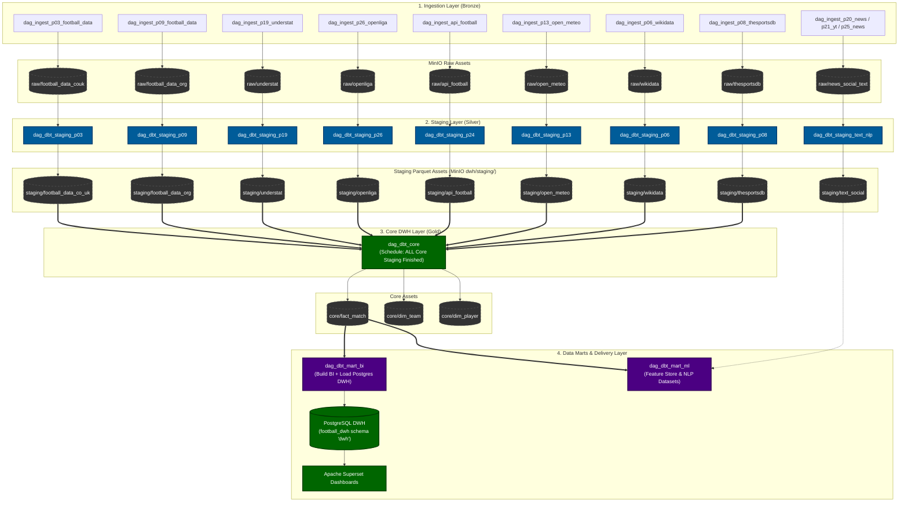

# KIẾN TRÚC AIRFLOW DATA LINEAGE & DATA-AWARE SCHEDULING (MODERN DATA STACK)

## 1. Tổng quan Kiến Trúc (Architecture Overview)

Dự án Football Lake được thiết kế và triển khai theo mô hình **Modern Data Stack (MDS)** với cơ chế điều phối **Data-Aware Scheduling (Airflow Assets / Datasets)**. 

Toàn bộ quy trình từ khâu cào dữ liệu (Ingestion), làm sạch (Staging), tích hợp và chuẩn hóa (Core) cho đến phân tích nâng cao (Marts BI & ML) được liên kết thành một đồ thị hướng có hướng (DAG Lineage) khép kín, hoạt động theo cơ chế **Event-Driven (hướng sự kiện)** thay vì lập lịch thời gian cứng (cron schedule).

---

## 2. Sơ đồ Đồ thị Dữ liệu Tổng thể (End-to-End Asset Lineage Graph)



---

## 3. Chi tiết Từng Tầng Xử Lý (Layer-by-Layer Specifications)

### 3.1. Tầng Ingestion (Bronze Layer)
* **Nhiệm vụ:** Cào/trích xuất dữ liệu thô từ các API công cộng, web scraping, và CDC PostgreSQL qua Debezium/Kafka.
* **Đầu ra:** File nén JSON (`.json.gz`) lưu trữ nguyên bản trên MinIO bucket `football-lake/raw/`.
* **Cơ chế kích hoạt:** Mỗi DAG cào dữ liệu kích hoạt theo `@daily` hoặc theo webhook/CDC event. Khi hoàn tất, task sẽ phát sinh **Raw Asset** (ví dụ: `Asset("minio://football-lake/raw/understat")`).

### 3.2. Tầng Staging (Silver Layer)
* **Nhiệm vụ:** Làm sạch, ép kiểu dữ liệu (casting types), xử lý giá trị NULL/placeholder và xuất ra định dạng chuẩn Parquet phân vùng.
* **Cơ chế kích hoạt:** Từng DAG Staging độc lập lắng nghe duy nhất Raw Asset của nguồn tương ứng:
  ```python
  dag = DAG(dag_id=f"dag_dbt_staging_{source_name}", schedule=[in_asset], ...)
  ```
* **Đầu ra:** Parquet file lưu tại `s3://football-lake/dwh/staging/<source_models>.parquet`.
* **Cơ chế phát sinh Asset:** Mỗi DAG Staging khi build dbt thành công sẽ phát sinh Staging Asset tương ứng:
  ```python
  BashOperator(
      task_id=f"dbt_run_{source_name}",
      bash_command=f"cd /opt/project/dbt && dbt build --select {dbt_models} --profiles-dir .",
      outlets=[out_asset],
  )
  ```

### 3.3. Tầng Core (Gold Layer - Data Warehouse)
* **Nhiệm vụ:** 
  - Khớp nối và giải quyết thực thể (Entity Resolution): hợp nhất tên CLB, cầu thủ qua `team_alias.csv` và `int_player_keys`.
  - Xây dựng bảng chiều (`dim_team`, `dim_player`, `dim_venue`, `dim_competition`, `dim_date`).
  - Xây dựng bảng sự kiện chính (`fact_match`, `fact_team_match`, `fact_goal`, `fact_player_season`).
* **Cơ chế kích hoạt (Toán tử AND `&`):**
  Core KHÔNG chạy giờ cố định (cron) mà **chỉ chạy khi TẤT CẢ các nguồn Staging cốt lõi đã sẵn sàng**:
  ```python
  core_schedule = (
      stg_football_data_co_uk
      & stg_football_data_org
      & stg_understat
      & stg_openliga
      & stg_api_football
      & stg_open_meteo
      & stg_wikidata
      & stg_thesportsdb
  )
  ```
* **Đầu ra:** Phát sinh Core Assets: `dim_team`, `dim_player`, `fact_match`.

### 3.4. Tầng Data Marts (Phục vụ Phân tích & Trực quan)
Được tách biệt hoàn toàn thành 2 nhánh độc lập:

1. **Mart BI (`dag_dbt_mart_bi`):**
   * **Điều kiện kích hoạt:** `schedule=[fact_match]`.
   * **Phạm vi build:** Chỉ build các model nghiệp vụ: `mart_bi_match_analysis`, `mart_bi_team_match`, `mart_bi_team_season`, `mart_bi_player_season`.
   * **Tự động hóa DWH:** Sau khi DuckDB build xong Parquet, task tiếp theo (`load_bi_to_postgres`) tự động nạp thẳng dữ liệu vào PostgreSQL database `football_dwh` schema `dwh`.
   * **Đầu ra:** Superset có ngay số liệu mới nhất để vẽ biểu đồ mà không cần thao tác thủ công. Phát sinh outlet `mart_bi`.

2. **Mart ML (`dag_dbt_mart_ml`):**
   * **Điều kiện kích hoạt:** `schedule=[fact_match]`.
   * **Phạm vi build:** Chỉ build các bảng feature phục vụ huấn luyện máy học: rolling form, lag stats, xG features, NLP text tables.
   * **Kiểm định chặt chẽ:** Tích hợp kiểm thử chống rò rỉ nhãn (`assert_ml_no_label_leakage`) và rò rỉ thời gian (`assert_ml_no_temporal_leakage`). Phát sinh outlet `mart_ml`.

---

## 4. Bảng Tra Cứu Danh Mục Airflow Assets (Asset Catalog)

| Tên Asset trong Code | URI Định danh | DAG Sinh Ra (Producer) | DAG Tiêu Thụ (Consumer) |
| :--- | :--- | :--- | :--- |
| **`football_data_co_uk`** | `minio://football-lake/raw/football_data_couk` | `dag_ingest_p03_football_data` | `dag_dbt_staging_p03_football_data_co_uk` |
| **`understat`** | `minio://football-lake/raw/understat` | `dag_ingest_p19_understat` | `dag_dbt_staging_p19_understat` |
| **`openliga`** | `minio://football-lake/raw/openliga` | `dag_ingest_p26_openliga` | `dag_dbt_staging_p26_openliga` |
| **`stg_football_data_co_uk`** | `duckdb://football-lake/staging/football_data_co_uk` | `dag_dbt_staging_p03...` | `dag_dbt_core` |
| **`stg_understat`** | `duckdb://football-lake/staging/understat` | `dag_dbt_staging_p19...` | `dag_dbt_core` |
| **`stg_openliga`** | `duckdb://football-lake/staging/openliga` | `dag_dbt_staging_p26...` | `dag_dbt_core` |
| **`stg_football_data_org`** | `duckdb://football-lake/staging/football_data_org` | `dag_dbt_staging_p09...` | `dag_dbt_core` |
| **`stg_api_football`** | `duckdb://football-lake/staging/api_football` | `dag_dbt_staging_p24...` | `dag_dbt_core` |
| **`stg_open_meteo`** | `duckdb://football-lake/staging/open_meteo` | `dag_dbt_staging_p13...` | `dag_dbt_core` |
| **`stg_wikidata`** | `duckdb://football-lake/staging/wikidata` | `dag_dbt_staging_p06...` | `dag_dbt_core` |
| **`stg_thesportsdb`** | `duckdb://football-lake/staging/thesportsdb` | `dag_dbt_staging_p08...` | `dag_dbt_core` |
| **`fact_match`** | `duckdb://football-lake/core/fact_match` | `dag_dbt_core` | `dag_dbt_mart_bi`, `dag_dbt_mart_ml` |
| **`dim_team`** | `duckdb://football-lake/core/dim_team` | `dag_dbt_core` | Downstream consumers |
| **`dim_player`** | `duckdb://football-lake/core/dim_player` | `dag_dbt_core` | Downstream consumers |
| **`mart_bi`** | `duckdb://football-lake/mart/bi` | `dag_dbt_mart_bi` | PostgreSQL DWH / Superset |
| **`mart_ml`** | `duckdb://football-lake/mart/ml` | `dag_dbt_mart_ml` | ML Training Pipelines |

---

## 5. Cơ chế Bảo vệ Tài nguyên & Chống Quá tải (Resource & Concurrency Management)

1. **Phân bổ Airflow Pools (`heavy_pool` vs `ingestion_pool`):**
   * `heavy_pool` (Giới hạn **1 slot**): Dành riêng cho các DAG nặng chạy dbt build (Core, Staging lớn, Marts, Open-Meteo). Đảm bảo tại một thời điểm **chỉ có duy nhất 1 tác vụ dbt** được phép chiếm dụng CPU và RAM in-memory.
   * `ingestion_pool` (Giới hạn **2 slots**): Dành cho các tác vụ I/O cào dữ liệu qua mạng, không tốn CPU.
2. **Khống chế mức độ đồng thời (`max_active_runs` & `max_active_tasks`):**
   * Mọi DAG transformation đều đặt `max_active_runs = 1` và `max_active_tasks = 1`, triệt tiêu hoàn toàn nguy cơ dồn ứ tác vụ hay race condition.
3. **Bộ đệm bộ nhớ ảo (Swap Buffer 4.0 GiB):**
   * Đã cấu hình Swap file 4GB trên ổ cứng SSD của máy ảo VM với `vm.swappiness = 10`. Khi các tiến trình DuckDB tổng hợp dữ liệu quy mô lớn, hệ thống tự động đẩy các trang RAM nhàn rỗi sang Swap, chống sập hệ thống (OOM Killer) và chống đơ kết nối SSH.
4. **Cơ chế Chống gián đoạn khi API bên ngoài gặp sự cố (Fault Tolerance):**
   * Đối với các nguồn phụ dễ gặp sự cố đường truyền (như TheSportsDB), pipeline được trang bị cơ chế tự động ghi nhận cảnh báo và bảo lưu dữ liệu hiện hữu, đảm bảo điều kiện `&` của tầng Core không bị phong tỏa vô hạn định.

---

## 6. Hướng dẫn Xem và Theo dõi trên Giao diện Airflow UI

1. Đăng nhập vào Airflow Webserver tại `http://<IP_VM>:8080`.
2. Trên thanh menu trên cùng, chọn tab **Datasets** (hoặc **Assets** trên Airflow 3.0+).
3. Tại giao diện đồ thị:
   * **Bên trái:** Chọn bất kỳ Asset nào (ví dụ `duckdb://football-lake/core/fact_match` hoặc `minio://football-lake/raw/football_news`).
   * **Chính giữa:** Airflow sẽ hiển thị trực quan toàn bộ cây gia phả: DAG nào tạo ra Asset đó và các DAG nào đang lắng nghe nó để kích hoạt.
   * **Bên phải:** Bảng lịch sử các sự kiện phát sinh Asset (`Asset Events`) kèm thời gian cập nhật chi tiết.
