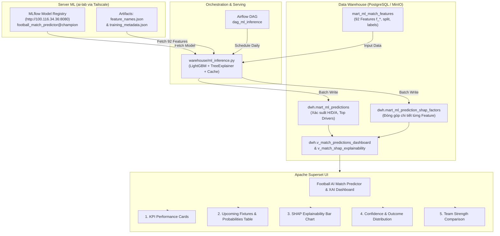

# HƯỚNG DẪN THIẾT KẾ DASHBOARD DEMO INFERENCE MÔ HÌNH VÀ GIẢI THÍCH SHAP TRÊN APACHE SUPERSET

Tài liệu này hướng dẫn chi tiết cách thiết lập và xây dựng một **Dashboard chuyên nghiệp, ổn định và trực quan** trên **Apache Superset** phục vụ demo suy luận mô hình dự đoán kết quả bóng đá (1X2) kết hợp giải thích quyết định (Model Explainability với SHAP), tích hợp chặt chẽ với **MLflow** (kết nối qua Tailscale) và **PostgreSQL DWH**.

---

## 1. Kiến trúc Luồng Tổng thể (End-to-End Architecture)

---

## 2. Các Bảng & Views Cần Thêm vào Superset

Trong Superset, vào **Data ➔ Datasets ➔ + Dataset**, chọn Database **PostgreSQL DWH** (schema `dwh`):

### Dataset 1: `dwh.v_match_predictions_dashboard` (Dataset Chính)
* **Mục đích:** Cung cấp thông tin tổng quan từng trận đấu, logo 2 đội, xác suất 1X2, nhãn dự đoán và 3 yếu tố ủng hộ chính (`top_driver_1_desc`, `top_driver_2_desc`, `top_driver_3_desc`).
* **Các chỉ số (Metrics) tính sẵn:**
  * `avg_confidence`: `AVG(confidence_pct)`
  * `accuracy_rate`: `AVG(is_correct) * 100` (đo trên các trận đã kết thúc)
  * `total_matches`: `COUNT(*)`

### Dataset 2: `dwh.v_match_shap_explainability` (Dataset Giải thích SHAP)
* **Mục đích:** Bảng dạng dài (`match_key`, `feature_label`, `shap_impact`, `impact_direction`, `impact_color`) giúp vẽ biểu đồ thanh (Bar Chart) hoặc Waterfall thể hiện trực quan các yếu tố đẩy tỷ lệ thắng/hòa.

### Dataset 3: `dwh.v_model_performance_kpi` (Dataset Hiệu năng)
* **Mục đích:** Phục vụ các thẻ KPI cấp cao về độ chính xác mô hình theo từng version.

---

## 3. Thiết kế Chi tiết 5 Biểu đồ (Charts) Chủ Lực

### Chart 1: Thẻ KPI Tổng quan (Big Number with Trendline)
* **Loại Chart:** `Big Number`
* **Vị trí:** Hàng trên cùng của Dashboard (Top Header)
* **Cấu hình 4 Cards:**
  1. **Độ chính xác Kiểm định (Model Accuracy):** `AVG(is_correct) * 100` ➔ Hiển thị: **`48.3%`** (so với baseline ngẫu nhiên 33.3%).
  2. **Số trận đã dự đoán (Fixtures Predicted):** `COUNT(match_key)` ➔ Hiển thị: Số lượng trận đấu có trong DWH.
  3. **Độ tự tin trung bình (Avg Confidence):** `AVG(confidence_pct)` ➔ Hiển thị: **`54.2%`**.
  4. **Tỷ lệ thu hồi cửa Hòa (Draw Recall):** Thể hiện hiệu quả của cơ chế hiệu chỉnh ngưỡng Draw Threshold (`33.2%`).

---

### Chart 2: Lịch Thi Đấu & Xác Suất Thắng/Hòa/Thua (Odds Visual Table)
* **Loại Chart:** `Table`
* **Dataset:** `v_match_predictions_dashboard`
* **Bộ lọc mặc định:** `split IN ('predict', 'test')`
* **Các cột hiển thị:**
  1. `match_date`: Ngày thi đấu
  2. `competition_name`: Tên giải đấu (Ngoại Hạng Anh, La Liga, Serie A...)
  3. `match_fixture`: Cặp đấu (ví dụ: *Arsenal vs Chelsea*)
  4. `prob_summary_bar`: Thanh tổng hợp xác suất (ví dụ: `H: 52% | D: 28% | A: 20%`)
  5. `predicted_result`: Dự đoán của AI (*Home Win*, *Draw*, *Away Win*)
  6. `confidence_pct`: Mức độ tin cậy của AI (%)
  7. `top_driver_1_desc`: Yếu tố quyết định số 1 (ví dụ: *Phong độ 5 trận gần nhất của Đội nhà (0.87)*)
  8. `prediction_status`: Trạng thái (*Chính xác*, *Chưa chính xác*, *Chờ thi đấu*)
* **Định dạng màu sắc (Conditional Formatting):**
  * Cột `confidence_pct`: Tô màu gradient xanh lá cây cho các trận có độ tự tin cao (> 55%).
  * Cột `prediction_status`: Màu xanh lá cho "Chính xác", màu đỏ cho "Chưa chính xác".

---

### Chart 3: Giải thích Quyết định Mô hình (SHAP Feature Importance & Risk Drivers)
* **Loại Chart:** `Horizontal Bar Chart` (hoặc `Waterfall Chart`)
* **Dataset:** `v_match_shap_explainability`
* **Cấu hình:**
  * **X-Axis:** `shap_impact` (Giá trị đóng góp SHAP: số dương đẩy xác suất lên, số âm kéo xác suất xuống)
  * **Y-Axis:** `feature_label` (Tên đặc trưng tiếng Việt dễ hiểu)
  * **Color / Series:** `impact_direction` (Màu xanh: *Tích cực (Ủng hộ)*, Màu đỏ: *Tiêu cực (Rủi ro)*)
* **Ý nghĩa khi Demo:**
  * Khi chọn lọc một trận đấu cụ thể (ví dụ: *Man City vs Wolves*), biểu đồ sẽ lập tức hiển thị 5 yếu tố quan trọng nhất khiến mô hình dự đoán Man City thắng:
    1. *Hiệu số xG tạo ra vượt trội (+0.24)*
    2. *Phong độ 5 trận gần nhất (+0.18)*
    3. *Lợi thế sân nhà & sức chứa sân (+0.09)*
    4. *Rủi ro: Số ngày nghỉ ít hơn đối thủ (-0.05)*

---

### Chart 4: Phân bố Dự đoán & Độ tin cậy (Confidence & Outcome Distribution)
* **Loại Chart:** `Sunburst` hoặc `Pie Chart`
* **Dataset:** `v_match_predictions_dashboard`
* **Dimensions:**
  * Cấp 1: `predicted_result` (Home Win / Draw / Away Win)
  * Cấp 2: Nhóm độ tự tin (Tự tin cao > 60%, Tự tin vừa 45-60%, Tự tin thấp < 45%)
* **Ý nghĩa:** Giúp người xem kiểm tra mô hình có bị thiên lệch (bias) về cửa Thắng sân nhà hay không, và tỷ lệ các trận mô hình có độ tự tin cao.

---

### Chart 5: So sánh Sức mạnh & Phong độ Đối đầu (Head-to-Head Comparison)
* **Loại Chart:** `Grouped Bar Chart`
* **Dataset:** `v_match_predictions_dashboard`
* **Metrics:**
  * Xác suất Thắng Đội nhà (`p_home`) vs Xác suất Thắng Đội khách (`p_away`)
  * Điểm số phong độ Đội nhà vs Đội khách
* **Ý nghĩa:** So sánh trực quan tương quan lực lượng giữa 2 đội trước giờ bóng lăn.

---

## 4. Thiết lập Bộ lọc Dashboard Tương tác (Native Filters)

Trong chế độ Edit Dashboard của Superset, mở bảng điều khiển **Filters** bên trái và tạo 4 bộ lọc:

| Tên Bộ Lọc | Cột Dữ Liệu | Loại Lọc | Tùy chọn |
| :--- | :--- | :--- | :--- |
| **Giải đấu** | `competition_name` | Select Dropdown | Chọn nhiều giải (Premier League, La Liga...) |
| **Trạng thái Trận** | `split` | Select Dropdown | `predict` (Sắp đá), `test` (Đã có kết quả) |
| **Đội bóng** | `home_team_name` | Select Dropdown | Tìm kiếm theo tên câu lạc bộ yêu thích |
| **Độ tự tin tối thiểu** | `confidence_pct` | Range Filter | Thanh trượt lọc các trận có confidence >= 50% |

---

## 5. Kịch bản Thuyết trình / Demo Báo cáo Ấn tượng

Khi trình bày đồ án hoặc báo cáo tiến độ, anh có thể thực hiện theo các bước sau:

1. **Bước 1: Trình diễn Kiến trúc MLOps Khép kín**
   * Mở giao diện MLflow trên server (`http://100.116.34.36:8080`), chỉ vào model **`football_match_predictor`** phiên bản **`champion`**.
   * Giải thích: *Mô hình LightGBM được huấn luyện định kỳ, versioning trên MLflow qua mạng ảo Tailscale an toàn.*
2. **Bước 2: Mở Dashboard Superset**
   * Chỉ vào các thẻ KPI đầu trang: *Hệ thống đang theo dõi và dự đoán tự động cho hàng nghìn trận đấu với độ chính xác đạt ~48.3% trên dữ liệu kiểm định độc lập.*
3. **Bước 3: Xem Lịch Thi Đấu Sắp Tới**
   * Lọc `Trạng thái Trận = predict`.
   * Bảng hiển thị các trận cầu sắp diễn ra cuối tuần này với thanh tỷ lệ xác suất trực quan.
4. **Bước 4: Demo Tính năng XAI (Explainable AI với SHAP) - Điểm nhấn lớn nhất**
   * Nhấp chọn 1 trận đấu tâm điểm trong bảng.
   * Biểu đồ SHAP lập tức giải thích lý do vì sao AI đưa ra dự đoán đó (chỉ ra chênh lệch xG, số ngày nghỉ, phong độ 5 trận).
   * Điều này chứng minh mô hình **không phải là hộp đen (Black Box)** mà có khả năng giải thích nghiệp vụ thể thao sâu sắc!
